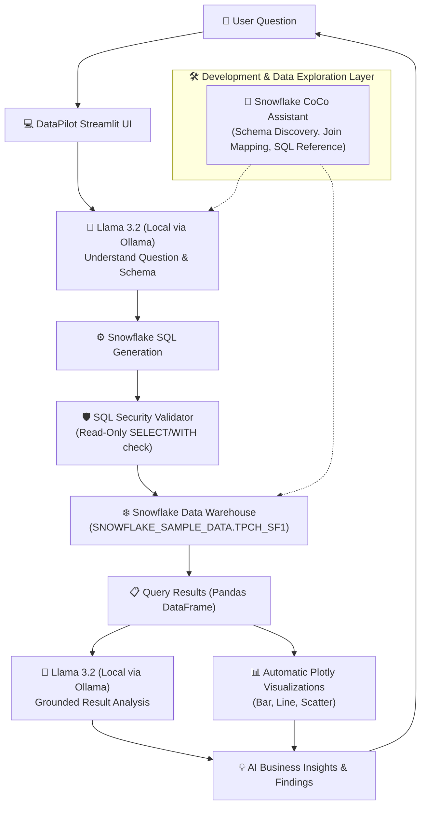

# DataPilot — Open-Source AI Data Analyst with Snowflake

DataPilot is an open-source AI-powered data analyst that allows users to ask questions about Snowflake data using natural language.
It uses Snowflake CoCo and the TPC-H sample dataset to explore data, generate and understand SQL queries, and extract useful insights.
An open-weight AI model analyzes the results and presents them through simple explanations and visualizations.
The goal is to make data analysis easier for non-technical users without requiring advanced SQL knowledge.

---

## 🏆 Hackathon Context

- **Event:** HackToBerFest Hack Day Mysore — VectorFlow Club
- **Track:** Track 1 — Challenge B: Best Open-Source AI Project with Snowflake
- **Team Name:** Bug Stars
- **Team Number:** 01
- **Team Members:**
  - Bindu shri N
  - Chaitra R

---

## 💡 Problem

In modern data-driven organizations, business stakeholders and non-technical decision makers possess valuable data stored in cloud warehouses like Snowflake. However, querying, visualizing, and analyzing this data often creates friction because:
1. Formulating analytical SQL requires specialized database expertise.
2. Relying on paid cloud AI APIs raises data privacy concerns, recurring API costs, and cloud vendor lock-in.
3. Raw database query results lack immediate, grounded business interpretation.

## 🚀 Solution

**DataPilot** democratizes enterprise data exploration by translating natural-language business questions into safe, executable Snowflake SQL, querying the standard **TPC-H SF1** sample dataset, generating interactive Plotly visualizations, and producing grounded AI insights.

All core AI reasoning—both text-to-SQL translation and analytical insight synthesis—is performed locally by the open-weight **Llama 3.2** model via **Ollama**, ensuring complete data privacy, offline capability, and zero API costs.

---

## 🏗️ Architecture



### End-to-End Workflow:
1. **User Question:** User types a question in plain English or picks a demo question.
2. **Llama 3.2 (Local AI):** Analyzes the question against dynamic Snowflake schema metadata.
3. **SQL Generation:** Translates intent into Snowflake SQL dialect.
4. **SQL Security Validation:** Verifies the query is strictly read-only (`SELECT` or `WITH`) and blocks destructive commands.
5. **Snowflake Execution:** Executes query on `SNOWFLAKE_SAMPLE_DATA.TPCH_SF1` using `snowflake-connector-python`.
6. **Automatic Visualization:** Inspects column data types to automatically render the ideal Plotly chart (Bar, Line, Scatter).
7. **AI Result Analysis:** Summarizes result set for Llama 3.2 to produce key insights, findings, trends, and business context.

---

## 🛠️ Technology Stack

| Component | Technology | Purpose |
| :--- | :--- | :--- |
| **Frontend / UI** | Streamlit | Responsive, interactive data dashboard |
| **Language** | Python 3.10+ | Core application logic and pipeline |
| **Cloud Data Platform** | Snowflake | Cloud data warehousing & analytics |
| **Dataset** | TPC-H SF1 (`SNOWFLAKE_SAMPLE_DATA.TPCH_SF1`) | Standard benchmark enterprise dataset |
| **Open-Weight AI** | Llama 3.2 (`llama3.2:latest`) | Local SQL generation and result analysis |
| **Local AI Runtime** | Ollama | Local inference engine running on localhost:11434 |
| **Dev & Exploration Assistant** | Snowflake CoCo | Schema exploration, join mapping & SQL development |
| **Visualizations** | Plotly & Plotly Express | Interactive charts (Bar, Line, Scatter, Area) |
| **Connector** | `snowflake-connector-python` | Secure database connection and query handling |
| **Configuration** | `python-dotenv` | Environment variable management |
| **Testing** | `pytest` | Unit testing of SQL security and validation rules |

---

## 🤝 How Snowflake CoCo Helped

**Snowflake CoCo** played a crucial role during the project development lifecycle:
1. **TPC-H SF1 Schema Discovery:** Explored the 8 core tables (`CUSTOMER`, `ORDERS`, `LINEITEM`, `PART`, `PARTSUPP`, `SUPPLIER`, `NATION`, `REGION`) and verified column naming conventions and data types.
2. **Relationship & Join Mapping:** Helped map foreign-key relationships across benchmark tables (e.g. `CUSTOMER.C_NATIONKEY` → `NATION.N_NATIONKEY` → `REGION.R_REGIONKEY`).
3. **Snowflake SQL Dialect Assistance:** Validated Snowflake-specific SQL functions such as `EXTRACT(YEAR FROM O_ORDERDATE)` and aggregation idioms.
4. **Validation of Exploration Ideas:** Assisted in formulating high-value analytical questions suitable for live hackathon evaluation.
5. **Development Support:** Streamlined workflow development and testing before integrating with the local LLM.

*(Note: In compliance with hackathon rules, CoCo is accurately represented as our development and data exploration assistant; runtime AI inference inside the application is powered exclusively by local Llama 3.2).*

---

## 🦙 Open-Weight AI (Llama 3.2 via Ollama)

Llama 3.2 is run locally through Ollama, allowing the prototype to perform AI-based SQL generation and result analysis without relying on a paid cloud LLM API.

- **Zero Cloud API Fees:** No dependence on OpenAI, Claude, or Gemini APIs.
- **Enterprise Data Privacy:** Database queries and data summaries never leave the local environment.
- **Low Latency:** Fast local inference on standard laptop hardware.

---

## 🛡️ SQL Security & Read-Only Safety

DataPilot enforces strict multi-layered SQL security before any query touches Snowflake:
- **Allowed Statements:** Only single `SELECT` or `WITH ... SELECT` statements.
- **Blocked Operations:** Strictly rejects `INSERT`, `UPDATE`, `DELETE`, `DROP`, `ALTER`, `CREATE`, `TRUNCATE`, `MERGE`, `GRANT`, `REVOKE`, `COPY`, `PUT`, `REMOVE`, `CALL`, and `EXECUTE`.
- **Multi-statement Prevention:** Detects and blocks semicolons chaining multiple statements.
- **Comment Stripping:** Strips `--`, `//`, and `/* ... */` comments prior to validation to avoid injection obfuscation.
- **Literal Masking:** Accurately distinguishes between SQL commands and words appearing inside string literals (e.g. `WHERE C_COMMENT LIKE '%DROP%'` is safely allowed).

---

## 📂 Project Structure

```
t1c2-bug-stars/
├── app.py                      # Main Streamlit web application
├── requirements.txt            # Python dependencies
├── .env.example                # Sample environment configuration template
├── .env                        # Local configuration (credentials, gitignored)
├── .gitignore                  # Git ignore rules
├── README.md                   # Project documentation
├── LICENSE                     # MIT License
├── ai/
│   ├── __init__.py
│   ├── ollama_client.py        # Local Ollama client & connection health check
│   ├── sql_generator.py        # Llama 3.2 prompt engineering & SQL extractor
│   └── result_analyzer.py      # Llama 3.2 grounded business insight generator
├── database/
│   ├── __init__.py
│   ├── snowflake_connection.py # Secure Snowflake connection manager
│   ├── schema_inspector.py     # Dynamic INFORMATION_SCHEMA inspector & fallback
│   └── query_executor.py       # Safe query execution and timing manager
├── visualization/
│   ├── __init__.py
│   └── charts.py               # Plotly automatic & custom chart builder
├── utils/
│   ├── __init__.py
│   └── sql_validator.py        # Robust SQL security & read-only validator
└── tests/
    ├── __init__.py
    └── test_sql_validator.py   # Pytest suite for SQL security constraints
```

---

## ⚡ Setup & Installation

### 1. Prerequisites
- **Python:** 3.10 or higher
- **Ollama:** Installed and running locally
- **Llama 3.2 Model:** Downloaded via Ollama:
  ```bash
  ollama pull llama3.2
  ```

### 2. Clone and Setup Environment
```bash
git clone https://github.com/VectorFlow-Club/t1c2-bug-stars.git
cd t1c2-bug-stars
```

### 3. Install Dependencies
```bash
pip install -r requirements.txt
```

### 4. Configure Environment Variables
Copy `.env.example` to `.env`:
```bash
cp .env.example .env
```
Edit `.env` and provide your Snowflake credentials:
```env
# Snowflake Connection Parameters
SNOWFLAKE_ACCOUNT=rwtlwzu-we51517
SNOWFLAKE_USER=BINDU709
SNOWFLAKE_PASSWORD=your_snowflake_password_here
SNOWFLAKE_WAREHOUSE=COMPUTE_WH
SNOWFLAKE_DATABASE=SNOWFLAKE_SAMPLE_DATA
SNOWFLAKE_SCHEMA=TPCH_SF1
SNOWFLAKE_ROLE=ACCOUNTADMIN

# Ollama Local Configuration
OLLAMA_BASE_URL=http://localhost:11434
OLLAMA_MODEL=llama3.2
```

*(Note: You can also launch the app and enter your Snowflake password securely directly within the Streamlit sidebar without saving it to disk).*

### 5. Run Security Tests
```bash
python -m pytest tests/
```

### 6. Launch DataPilot
```bash
streamlit run app.py
```
The application will open in your browser at `http://localhost:8501`.

---

## 💬 Demo Example Questions

Try asking any of these questions directly in DataPilot:

1. **Top Customers by Spending:**
   > *"Show me the top 10 customers by total spending."*
   - Generated SQL joins `CUSTOMER` and `ORDERS`, groups by customer, and calculates total order expenditure.

2. **Customer Distribution by Nation:**
   > *"Which nations have the most customers?"*
   - Joins `NATION` and `CUSTOMER`, ranking countries by total registered customer count.

3. **Yearly Order Progression:**
   > *"Show the number of orders by year."*
   - Extracts year from `O_ORDERDATE` and renders an interactive chronological trend line.

4. **Regional Revenue Breakdown:**
   > *"Which regions have the highest revenue?"*
   - Multi-table join across `REGION`, `NATION`, `CUSTOMER`, and `ORDERS` aggregating total revenue per global market.

5. **Top Suppliers by Balance:**
   > *"Show the top 10 suppliers by account balance."*
   - Analyzes `SUPPLIER` account balances and identifies top credit suppliers.

---

## 📄 License

This project is licensed under the terms of the [MIT License](LICENSE).  
Copyright (c) 2026 **Bug Stars**.
